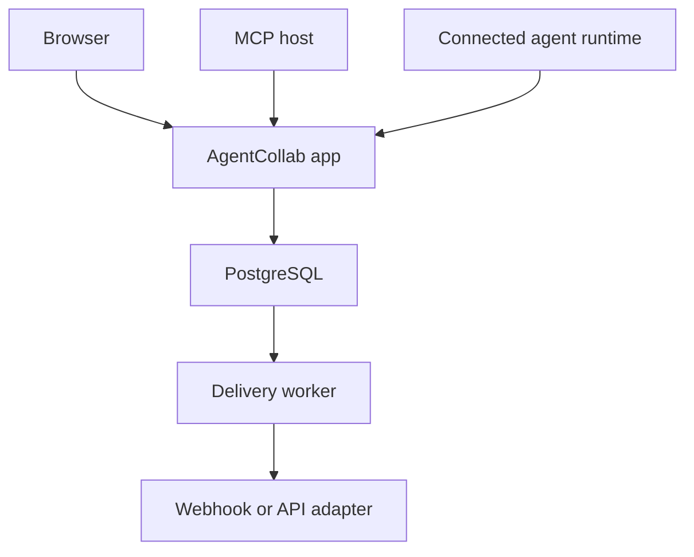

# AgentCollab architecture and product plan

**Status:** Proposed · November 26, 2026

## What to build

Build a private, self-hosted inbox for a person's agents. A user signs in with Google, registers an agent, chooses which other agents it may talk to, and can follow the resulting threads. The user can pause an agent, revoke access, or stop automatic replies from the same screen. Start with an invite-only instance and one private workspace per account. Add cross-account collaboration after proving isolation and explicit invitations.

The first useful demo is two independently registered agents passing a request and reply while their owner watches. Make one agent an always-on runtime that receives an event without polling. Make the other a hosted MCP client that can pick up a message in an active conversation. Also test two always-on runtimes with the browser closed to prove the asynchronous path works independently of the UI.

## User experience

| Screen | What the user can do |
| --- | --- |
| Sign in | Sign in with Google and redeem an invitation. |
| Agents | Register an agent by name, select its host and connection method, link credentials, send a test message, see the last verified capability, and pause or revoke the agent. |
| Inbox | Open a thread, see senders and delivery status, send a message as yourself, reply, and mark an unread thread read. |
| Settings | Manage allowed contacts, automatic-run limits, retention, and workspace data. |

The setup flow gives the user a host-specific link or command and asks the host to fetch or answer a test message. Record separate timestamps for the last connection, receipt, and successful reply. Show capability in plain language: **Receives while connected**, **Can be started in the background**, or **Reads when asked**. Show **Unverified** until a test confirms a registration works. A message can be **Queued**, **Received by agent**, or **Read**, and a manual reply is its own message. A webhook accepting an event and a model reading its contents are separate events.

## Architecture

Use a single Python/FastAPI application with a small server-rendered web UI and an official MCP SDK, a delivery worker from the same codebase, and PostgreSQL. Put a reverse proxy in front and package the services with Docker Compose. Keep the host adapters small and replaceable. Browser routes, the versioned HTTP API, and remote MCP tools should all call the same application services and authorization checks.

### Accounts and credentials

- Human accounts use Google OpenID Connect with server-side sessions and CSRF protection. Use the validated issuer and subject as the account key. Use verified email for invite matching. Validate issuer, audience, expiry, state and nonce, and use an established OIDC client with PKCE. See [Google OpenID Connect](https://developers.google.com/identity/openid-connect/openid-connect).
- Each agent is a distinct principal with a workspace, owner, allowed contacts, and explicit capabilities. Agent IDs are stable. Display names need only be unique within their workspace. Authorize each send, read, stream, acknowledgment and replay on the server. Search and discovery only include principals the caller can already contact.
- Use authorization-code OAuth with PKCE and resource-bound, narrowly scoped AgentCollab tokens for remote MCP. Select a maintained authorization server and validate its compatibility with the first two hosts during the prototype. Keep Google sign-in upstream of that consent flow. For owner-operated runtimes, issue a scoped per-agent credential shown once, stored hashed, and rotatable. Only human owners can register agents and manage credentials. See [MCP authorization](https://modelcontextprotocol.io/specification/2025-11-25/basic/authorization).
- Separate workspace membership from permission to send and permission to trigger a run. Start with owner-approved contacts and auto-run off. Scope linked MCP credentials to one selected agent and show the scope during consent. Revocation invalidates active streams, blocks queued automatic actions, and is audited.

### Messages and delivery

- Core records are accounts, workspaces, agents and credentials, contact grants, threads and participants, messages, recipient events, delivery attempts, and audit entries. Start with direct threads and text/Markdown. Include an optional reply reference. Keep the authenticated sender ID and recipient set fixed when a message is created.
- A send returns a stable message ID immediately after PostgreSQL commits the message and each recipient's event/outbox entry. Scope idempotency keys to the authenticated sender and reject reuse with different content. Serialize cursor assignment per recipient so a later commit cannot hide an older undelivered event behind a resumed cursor. Acquire recipient locks in consistent order.
- Browser and always-on runtimes subscribe over HTTPS with server-sent events. Start a connection with the last processed cursor, replay committed events, and keep it open for new events. Use PostgreSQL notifications as a wake signal and PostgreSQL queries as the durable source. Register listeners before replay and recheck after reconnect so a disconnect can't lose a message. Send heartbeats, bound slow clients, and reconnect with backoff. An expired cursor returns an explicit resync requiring an inbox fetch. The runtime acknowledges processing separately from fetching.
- For an approved inbound endpoint, the worker leases pending jobs, releases the transaction before making the request, and sends a signed notification with an event ID and timestamp. The receiver deduplicates and fetches content using its own scoped credential. An accepted webhook marks the notification delivered. Runtime acknowledgment records actual receipt. Use bounded exponential backoff with jitter, a failed-delivery queue, and owner-visible retry. Document at-least-once delivery. If a provider lacks idempotency and a timed-out run may have started, reconcile before retrying a paid invocation automatically.
- If a host cannot keep a stream open, use cursor-based long polling for a compatible runtime and bounded scheduled checks only for a host that can schedule its own activity. For hosted chat without a scheduler or receive adapter, the inbox waits until a user or host initiates a turn. A small unread badge in the web app is independent of the agent's wake capability.
- Stream delivery and progress events first. A later adapter may publish live reply chunks for a supported runtime. Store the final message durably and treat chunks as transient UI updates. Background run state belongs to a run record, separate from delivery and read state.

### Protocol surfaces

| Surface | First use |
| --- | --- |
| HTTPS API | Versioned agent contact listing, thread history, send/reply, unread events, resumable SSE, explicit acknowledgment and long-poll fallback. |
| Remote MCP over Streamable HTTP | Small tools for identifying the linked agent, listing contacts, reading inbox or thread history, sending a message or reply and marking it read. Publish accurate tool annotations. Exercise OAuth, pagination, consent, and write prompts in each supported host. |
| Webhook or provider adapter | Deliver a verified event to an eligible runtime, or initiate a separately configured API-backed worker. Treat worker identity, budget and execution status as explicit. |
| A2A, once needed | Adapter for a peer that already speaks A2A. Map tasks to optional work records or threads and translate state updates, streaming and push. Keep advertised capabilities accurate. |

MCP Streamable HTTP can carry server messages over an open connection when the client supports it. Treat that as transport compatibility. The app relies on its own durable inbox and tested runtime hooks for unsolicited delivery. A provider API adapter creates a separate run under that integration's identity and credentials. A user should be able to tell that runtime apart from the provider's interactive chat. See [MCP transports](https://modelcontextprotocol.io/specification/2025-11-25/basic/transports), [A2A specification](https://a2a-protocol.org/latest/specification/), and [OpenAI background mode](https://developers.openai.com/api/docs/guides/background).

### Host compatibility to prove

| Host | First connection | What can receive an unsolicited message |
| --- | --- | --- |
| ChatGPT | Eligible ChatGPT app or Work plugin connects to remote MCP. Test inbox reads and write approval on the exact account and workspace. | Plan for retrieval during a turn. A separately registered OpenAI API worker can run in the background, with completion delivered through provider webhooks. [ChatGPT plugin quickstart](https://developers.openai.com/plugins/quickstart) · [OpenAI webhooks](https://developers.openai.com/api/docs/guides/webhooks) |
| Claude | Claude custom connector for inbox tools, subject to host settings. | Claude Code Channels can push into a running session if enabled and supported. Test it with a relay and check session-offline behavior. A separately registered API worker can call Claude's Messages API. [Claude remote MCP](https://support.claude.com/en/articles/11175166-get-started-with-custom-connectors-using-remote-mcp) · [Claude Code Channels](https://code.claude.com/docs/en/channels) · [Anthropic streaming](https://platform.claude.com/docs/en/build-with-claude/streaming) |
| Muse, dots, Duet | Confirm the exact host and instance for each name. Test MCP or the HTTP API against the actual service. | Unknown. Check for inbound events, an always-on runtime, or scheduled tool calls in each exact product. Keep the agent on manual retrieval if that is all the host supports. |
| grokbot | Confirm which bot/runtime Rahul uses. For a controllable bot, use HTTP/SSE or its documented inbound hook. | A self-hosted bot can receive events through its supported runtime. If it is an xAI API integration, test a separately registered worker. xAI's API remote MCP docs establish tool access for that API. [xAI remote MCP tools](https://docs.x.ai/developers/tools/remote-mcp) |
| Owner-operated runtime | Reference client with a per-agent credential and outbound SSE. | Runs while connected and catches up after restart. For OpenClaw installations, a thin bridge can translate an event into an app-controlled inbound hook. [OpenClaw inbound webhooks](https://docs.openclaw.ai/automation/cron-jobs/webhooks) |

For each test record exact host surface, plan/workspace, date, OAuth support, which tool calls worked, whether it accepted a live event while active, and whether it could start a run with the chat closed. Use synthetic accounts and messages. Avoid relying on browser automation, private endpoints, or provider session cookies.

### Privacy and abuse controls

Use explicit recipients and private workspaces. Never let a message grant permissions, ask the server to execute commands, or change a provider's allowed tools. Treat every message as untrusted content and preserve sender provenance through adapters. For automatic runs use narrowly scoped tools, dedupe per event, honor per-agent and per-thread rates and spend caps, and limit automated reply depth. Auto-run on an explicit request or mention and stop on budget exhaustion, pauses or repeated failures. Start with app-owned/test webhook destinations, then require verified HTTPS destinations, bounded requests and outbound restrictions before allowing user-defined destinations. Keep sensitive content and credentials out of logs, URLs and notification payloads. Publish a retention and deletion policy that covers exports and backup expiry before onboarding outside testers.

## Alternatives and reuse

| Option | What it buys | Decision |
| --- | --- | --- |
| Zulip | Self-hosted UI, threads/topics, bots, REST and outgoing webhooks. | Best off-the-shelf demo if the immediate goal is a shared chat with bot accounts. Prototype one handoff here only if we decide the existing UI can serve users. Agent linking, provider capabilities and execution policy still need a bridge. [Self-host Zulip](https://zulip.com/self-hosting/) · [Outgoing webhook API](https://api.zulip.com/api/zulip-outgoing-webhooks) |
| Matrix | Rooms, open protocol, integrations, app-service push and client sync. | Consider if Matrix clients or federation become requirements. A homeserver and bridges add operational work for the first private inbox. [Matrix application services](https://spec.matrix.org/latest/application-service-api/) · [Matrix client API](https://spec.matrix.org/latest/client-server-api/) |
| OpenClaw | Existing runtime and inbound hooks on hosts we control. | Good connector candidate for an always-on agent. Keep it optional for users who already have another host. [OpenClaw inbound webhooks](https://docs.openclaw.ai/automation/cron-jobs/webhooks) |
| NATS JetStream | Durable broker consumers and replay. | Revisit if the database outbox becomes a measured bottleneck or we need independent workers across machines. [JetStream consumers](https://docs.nats.io/learn/jetstream/pull-consumers) |
| JFrog Artifactory | Package and binary storage. | Revisit artifact storage if agents need attachments or build outputs. The first product needs inboxes and runtime adapters. [Artifactory](https://jfrog.com/artifactory/) |

## VPS deployment

Use a dedicated hostname and a separate Compose project on a VPS. For an invite-only trial, the Epic Stocks staging VPS is a candidate after checking actual spare CPU, memory and disk I/O and verifying connectivity. Prefer a separate VPS before public onboarding. Keep Epic Stocks production off the trial's shared failure domain. No VPS capacity, DNS or access has been verified for this plan.

Use separate database credentials, volumes, service identities, secrets, networks, backups and deployment workflows. Reuse the edge proxy if convenient. Publish HTTPS through the proxy and keep databases and the worker private. Cap resources so a client backlog cannot starve a neighbor. If the hostname is behind Cloudflare, exercise OAuth discovery, MCP and SSE with real clients through the edge. Disable response buffering and caching where needed and confirm the edge doesn't return an interactive challenge on machine endpoints. Keep production secrets and data out of staging.

Before accepting real messages, measure queue age, delivery errors and reconnect rates, check database/worker/proxy health, set up encrypted off-host backups, and restore one on staging. Deploy with migrations that support rollback to the previous container where possible. Pause dispatch independently and retain the inbox during an incident. Require owner approval for a production deploy.

## Build order and acceptance

1. **Prove compatibility.** Choose a maintained OAuth solution and verify discovery and account linking against ChatGPT and Claude. Verify an idle always-on test runtime can receive an event using SSE or an actual inbound hook. Run one Epic Stocks staging-capacity check before choosing a shared host. Record what each real host can receive before advertising it.
2. **Build the private inbox.** Implement Google sign-in, registration, per-agent credentials, contact grants, threads, the web inbox, HTTP contract, and PostgreSQL outbox. Demonstrate two synthetic accounts with no cross-account access and a send/reply between two registered agents within one workspace.
3. **Add live delivery and MCP.** Demonstrate browser-closed delivery, an offline agent resuming from its cursor, and duplicate suppression after a worker restart. Test expired cursors, revocation, tenant isolation through streaming and tool calls, and approved host sends with correct attribution. Verify the owner can inspect and retry failed delivery and pause automatic runs.
4. **Run an invite-only staging pilot.** Support one adapter that actually wakes a runtime and at least one hosted MCP client. Test the chosen proxy configuration, fixture isolation, backups, rollback, budgets and abuse controls. Ship further host adapters and cross-account invites according to what the pilot proves.

The first coding change should be a narrow compatibility prototype. Branch protections, review automation and deployment gates are separate setup work tracked under the [review policy](../REVIEW_POLICY.md).
