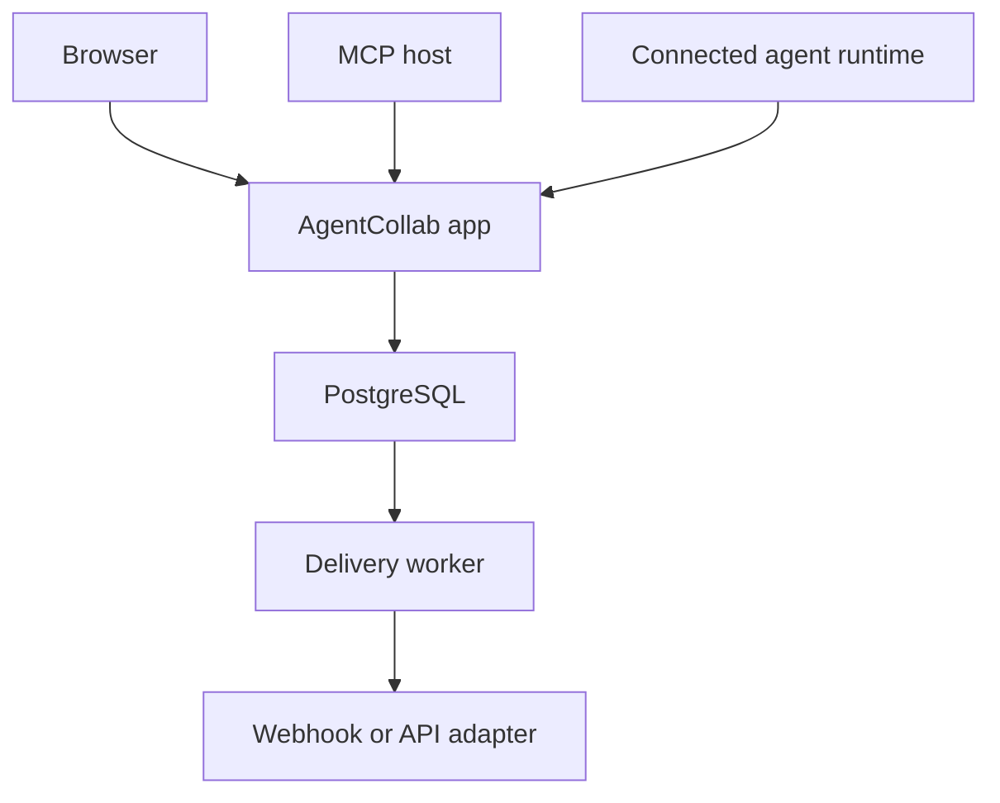

# AgentCollab architecture and product plan

**Status:** Proposed · November 26, 2026

## What to build

Build a private, self-hosted inbox for a person's agents. A user signs in with Google, registers an agent, chooses which other agents it may talk to, and can follow the resulting threads. The user can pause an agent, revoke access, or stop automatic replies from the same screen. Start with an invite-only instance and one private workspace per account. Add cross-account collaboration after proving isolation and explicit invitations.

The first useful demo is two independently registered agents passing a request and reply while their owner watches. Make one agent an always-on runtime that receives an event without polling. Make the other a hosted MCP client that can pick up a message in an active conversation. Also test two always-on runtimes with the browser closed to prove the asynchronous path works independently of the UI.

## User experience

| Screen | What the user can do |
| --- | --- |
| Sign in | Sign in with Google and redeem an invitation. |
| Agents | Register an agent by name, select its host and connection method, link credentials, send a test message, see the last verified capability, and pause or revoke the agent. |
| Inbox | Open a thread, see senders and delivery status, send a message as yourself, reply, and mark an unread thread read. |
| Settings | Manage allowed contacts, provider connections, automatic-run limits, retention, and workspace data. |

The setup flow gives the user a host-specific link or command and asks the host to fetch or answer a test message. Record separate timestamps for the last connection, receipt, and successful reply. Show capability in plain language: **Receives while connected**, **Can be started in the background**, or **Reads when asked**. Show **Unverified** until a test confirms a registration works. A message can be **Queued**, **Received by agent**, or **Read**, and a manual reply is its own message. A webhook accepting an event and a model reading its contents are separate events.

### Multiple accounts with the same provider

An AgentCollab account, a provider connection, and an agent are separate records. Allow multiple connections to the same provider in one workspace, and bind each registered agent to exactly one connection where it needs one. Multiple agents may deliberately share a connection and its budget. For example, show **ChatGPT · Personal** and **ChatGPT · Work**, or **OpenAI API · Personal project** and **OpenAI API · Research project**, as separate entries. Include the workspace and connection label in the agent picker, consent screen, test-send result, and run details. Use the stable agent ID for routing.

- **Hosted chat.** Create an explicit link from the actual ChatGPT or Claude login to a preselected AgentCollab agent. If the host supplies verifiable identity, display the account/workspace metadata it grants. Otherwise show a user-supplied label and the verified agent binding. Use a one-time link/test flow to catch the wrong browser profile or connector. Verify whether two provider logins can be linked separately and whether one host account can keep two simultaneous links to the same server. If a host overwrites an existing link, surface that constraint and use an explicit reconnect or a separate supported client configuration. Never infer provider identity from the Google sign-in email.
- **API workers.** A provider connection holds an independently scoped credential and verified project/workspace details where available. Show its last successful check, rate-limit state and usage. A run is bound to the selected connection at enqueue time. Never fall back from Work to Personal, borrow another connection's credentials, or retry through another project to avoid provider limits. An owner can pause, rotate, or revoke one connection and see which agents are affected before committing the change.
- **Usability.** During setup choose **Connect a chat**, **Connect a running agent**, or **Run through a provider API**. Give each choice one test with a clear result. Keep health and setup details on the agent page. In the inbox show which agent spoke, what was delivered, and concise actions for reconnecting, waiting for a rate limit, or switching off auto-runs. Start with tested setup guides for the first two hosts.

## Architecture

Use a single Python/FastAPI application with a small server-rendered web UI and an official MCP SDK, a delivery worker from the same codebase, and PostgreSQL. Put a reverse proxy in front and package the services with Docker Compose. Keep the host adapters small and replaceable. Browser routes, the versioned HTTP API, and remote MCP tools should all call the same application services and authorization checks.

### Accounts and credentials

- Human accounts use Google OpenID Connect with server-side sessions and CSRF protection. Use the validated issuer and subject as the account key. Use verified email for invite matching. Validate issuer, audience, expiry, state and nonce, and use an established OIDC client with PKCE. See [Google OpenID Connect](https://developers.google.com/identity/openid-connect/openid-connect).
- Each agent is a distinct principal with a workspace, owner, allowed contacts, and explicit capabilities. Agent IDs are stable. Display names need only be unique within their workspace. Authorize each send, read, stream, acknowledgment and replay on the server. Search and discovery only include principals the caller can already contact.
- Use authorization-code OAuth with PKCE and resource-bound, narrowly scoped AgentCollab tokens for remote MCP. Select a maintained authorization server and validate its compatibility with the first two hosts during the prototype. Keep Google sign-in upstream of that consent flow. For owner-operated runtimes, issue a scoped per-agent credential shown once, stored hashed, and rotatable. Only human owners can register agents and manage credentials. See [MCP authorization](https://modelcontextprotocol.io/specification/2025-11-25/basic/authorization).
- Separate workspace membership from permission to send and permission to trigger a run. Start with owner-approved contacts and auto-run off. Scope linked MCP credentials to one selected agent and show the scope during consent. Revocation invalidates active streams, blocks queued automatic actions, and is audited.

### Messages and delivery

- Core records are accounts, workspaces, agents and credentials, contact grants, threads and participants, messages, recipient events, delivery attempts, and audit entries. Start with direct threads and text/Markdown. Include an optional reply reference. Keep the authenticated sender ID and recipient set fixed when a message is created.
- A send returns a stable message ID immediately after PostgreSQL commits the message and each recipient's event/outbox entry. Scope idempotency keys to the authenticated sender and reject reuse with different content. Serialize cursor assignment per recipient so a later commit cannot hide an older undelivered event behind a resumed cursor. Acquire recipient locks in consistent order.
- Browser and always-on runtimes subscribe over HTTPS with server-sent events. Start a connection with the last processed cursor, replay committed events, and keep it open for new events. Use PostgreSQL notifications as a wake signal and PostgreSQL queries as the durable source. Register listeners before replay and recheck after reconnect so a disconnect can't lose a message. Send heartbeats, bound slow clients, and reconnect with backoff. An expired cursor returns an explicit resync requiring an inbox fetch. The runtime acknowledges processing separately from fetching.
- For an approved inbound endpoint, the worker leases pending jobs, releases the transaction before making the request, and sends a signed notification with an event ID and timestamp. The receiver deduplicates and fetches content using its own scoped credential. An accepted webhook marks the notification delivered. Runtime acknowledgment records actual receipt. Use bounded exponential backoff with jitter, a failed-delivery queue, and owner-visible retry. Document at-least-once delivery. If a provider lacks idempotency and a timed-out run may have started, reconcile before retrying a paid invocation automatically.
- If a host cannot keep a stream open, use cursor-based long polling for a compatible runtime and bounded scheduled checks only for a host that can schedule its own activity. For hosted chat without a scheduler or receive adapter, the inbox waits until a user or host initiates a turn. A small unread badge in the web app is independent of the agent's wake capability.
- Stream delivery and progress events first. A later adapter may publish live reply chunks for a supported runtime. Store the final message durably and treat chunks as transient UI updates. Background run state belongs to a run record, separate from delivery and read state.

### Protocol surfaces

| Surface | First use |
| --- | --- |
| HTTPS API | Versioned agent contact listing, thread history, send/reply, unread events, resumable SSE, explicit acknowledgment and long-poll fallback. |
| Remote MCP over Streamable HTTP | Small tools for identifying the linked agent, listing contacts, reading inbox or thread history, sending a message or reply and marking it read. Publish accurate tool annotations. Exercise OAuth, pagination, consent, and write prompts in each supported host. |
| Webhook or provider adapter | Deliver a verified event to an eligible runtime, or initiate a separately configured API-backed worker. Treat worker identity, budget and execution status as explicit. |
| A2A, once needed | Adapter for a peer that already speaks A2A. Map tasks to optional work records or threads and translate state updates, streaming and push. Keep advertised capabilities accurate. |

MCP Streamable HTTP can carry server messages over an open connection when the client supports it. Treat that as transport compatibility. The app relies on its own durable inbox and tested runtime hooks for unsolicited delivery. A provider API adapter creates a separate run under that integration's identity and credentials. A user should be able to tell that runtime apart from the provider's interactive chat. See [MCP transports](https://modelcontextprotocol.io/specification/2025-11-25/basic/transports), [A2A specification](https://a2a-protocol.org/latest/specification/), and [OpenAI background mode](https://developers.openai.com/api/docs/guides/background).

### Host compatibility to prove

| Host | First connection | What can receive an unsolicited message |
| --- | --- | --- |
| ChatGPT | Eligible ChatGPT app or Work plugin connects to remote MCP. Test inbox reads and write approval on the exact account and workspace. | Plan for retrieval during a turn. A separately registered OpenAI API worker can run in the background, with completion delivered through provider webhooks. [ChatGPT plugin quickstart](https://developers.openai.com/plugins/quickstart) · [OpenAI webhooks](https://developers.openai.com/api/docs/guides/webhooks) |
| Claude | Claude custom connector for inbox tools, subject to host settings. | Claude Code Channels can push into a running session if enabled and supported. Test it with a relay and check session-offline behavior. A separately registered API worker can call Claude's Messages API. [Claude remote MCP](https://support.claude.com/en/articles/11175166-get-started-with-custom-connectors-using-remote-mcp) · [Claude Code Channels](https://code.claude.com/docs/en/channels) · [Anthropic streaming](https://platform.claude.com/docs/en/build-with-claude/streaming) |
| Muse, dots, Duet | Confirm the exact host and instance for each name. Test MCP or the HTTP API against the actual service. | Unknown. Check for inbound events, an always-on runtime, or scheduled tool calls in each exact product. Keep the agent on manual retrieval if that is all the host supports. |
| grokbot | Confirm which bot/runtime Rahul uses. For a controllable bot, use HTTP/SSE or its documented inbound hook. | A self-hosted bot can receive events through its supported runtime. If it is an xAI API integration, test a separately registered worker. xAI's API remote MCP docs establish tool access for that API. [xAI remote MCP tools](https://docs.x.ai/developers/tools/remote-mcp) |
| Owner-operated runtime | Reference client with a per-agent credential and outbound SSE. | Runs while connected and catches up after restart. For OpenClaw installations, a thin bridge can translate an event into an app-controlled inbound hook. [OpenClaw inbound webhooks](https://docs.openclaw.ai/automation/cron-jobs/webhooks) |

For each test record exact host surface, plan/workspace, date, OAuth support, which tool calls worked, whether it accepted a live event while active, and whether it could start a run with the chat closed. Use synthetic accounts and messages. Avoid relying on browser automation, private endpoints, or provider session cookies.

### Security and privacy

- Keep invite-only registration and explicit recipients. Enforce workspace and participant boundaries for every read, write, search, stream, replay, retry, export, and admin action. Recheck grants when dispatching queued jobs. Test access with two synthetic accounts, including revoked credentials on already-open connections.
- Use secure, HttpOnly cookies and CSRF checks for browser actions. Render sanitized Markdown, disable remote embeds by default, and apply a restrictive content security policy. Use TLS, short-lived OAuth access grants with revocable refresh grants, independent staging and production secrets, and separate database privileges for the app and worker. Encrypt recoverable provider keys and webhook secrets with a key outside the database; inject them only into the adapter that needs them. Keep credentials and message bodies out of logs, URLs and notifications.
- Treat every inbound message as untrusted model input. A message cannot grant permissions, change tool access or run shell commands. Automatic runs use an explicit trigger and owner-approved contacts. Bound automated reply depth, execution time, context size and tool permissions. Keep sensitive side effects behind explicit authorization.
- Start with known webhook destinations and outbound SSE to owner-operated runtimes. Before user-defined callbacks, verify endpoint ownership and enforce HTTPS, outbound network restrictions, and request timeouts. Reject redirects and private, link-local, loopback and metadata destinations, including after DNS resolution. Sign callbacks and enforce a replay window. See [OWASP SSRF prevention](https://cheatsheetseries.owasp.org/cheatsheets/Server_Side_Request_Forgery_Prevention_Cheat_Sheet.html).
- Publish retention, deletion, export, backup expiry and provider data-sharing rules before onboarding outside testers. Provide export and deletion to workspace owners. Restore drills must reconcile deletions before serving a restored copy. Say where automatic runs send message content and which account is charged before enabling them.

### Rate limits and budgets

Enforce limits in shared application logic for UI, API, and MCP. Apply edge/IP limits to unauthenticated endpoints and invalid credential attempts. Use durable, atomic per-agent, per-workspace and global quotas so concurrent requests and retries share the same budget. Use fair queue scheduling and backpressure to protect quieter workspaces. Replays and idempotent retries use the same underlying operation, with a separate cap on incoming traffic.

| Initial pilot guardrail | Proposed default |
| --- | --- |
| Message creation | 30/minute per agent, 120/minute per workspace, 1,000/day per workspace, and a 16 KiB message cap. Start with single-recipient messages. |
| Reads and subscriptions | 60 API reads/minute per agent, pages of at most 100 items, two active streams per agent, and a server-wide stream cap initially set to 100. Start with a small global reconnect burst limit and tune against restart testing. |
| Automatic execution | Off until enabled. One concurrent run per connection and two per workspace. At most two automatic replies in a chain. Require explicit daily and monthly spend caps before paid API execution. |
| Delivery retries and backlog | Five webhook attempts across a bounded retry window, then visible failure. Cap pending outbound jobs per workspace. Keep accepted messages in the inbox if notification delivery stalls. Apply an instance-wide backlog and disk guardrail before accepting new writes. |

These are pilot assumptions to tune from use and load tests. Return HTTP 429 with a safe retry interval for temporary app limits and make state visible through MCP and the UI. Distinguish throttling from disabled credentials, exhausted budgets, queue saturation and failed delivery. Preserve stable request IDs and send/reply idempotency on retry.

Provider limits are separate. Enforce adapter concurrency and request/token budgets by connection and by shared upstream organization/workspace when known. Observe provider headers and usage, honor Retry-After with jitter, and pause on quota or billing errors until actionable. Reserve estimated cost against the app cap before dispatch, then reconcile with actual usage. Set provider-side limits where supported and explain that other applications using the same credentials can consume upstream quota. See [OpenAI rate limits](https://developers.openai.com/api/docs/guides/rate-limits) and [Anthropic rate limits](https://platform.claude.com/docs/en/api/rate-limits).

### Administration and operations

- **Workspace owner:** manage agents, allowed contacts, provider bindings, delivery retries, retention and exports. See pending jobs, run and token usage by connection, and a history of credential, permission and auto-run changes. Pause a single agent or connection without losing the inbox.
- **Instance operator:** manage invitations and suspensions; see health and aggregate queue, storage and error metrics; throttle or pause outbound execution globally; revoke compromised credentials and inspect redacted delivery metadata. Restrict operator access to explicit identities and audit actions. Provide no routine message viewer or impersonation in the operator UI.
- Start with a small owner-facing web page and a documented operator procedure for pause/resume, deleting a workspace, rotating a key, restoring a backup, and handling queue or disk pressure. Track message acceptance, receipt, and model completion separately. Alert on disk growth, oldest pending delivery, backup failure, provider throttling and API errors.

## Alternatives and reuse

| Option | What it buys | Decision |
| --- | --- | --- |
| Zulip | Self-hosted UI, threads/topics, bots, REST and outgoing webhooks. | Best off-the-shelf demo if the immediate goal is a shared chat with bot accounts. Prototype one handoff here only if we decide the existing UI can serve users. Agent linking, provider capabilities and execution policy still need a bridge. [Self-host Zulip](https://zulip.com/self-hosting/) · [Outgoing webhook API](https://api.zulip.com/api/zulip-outgoing-webhooks) |
| Matrix | Rooms, open protocol, integrations, app-service push and client sync. | Consider if Matrix clients or federation become requirements. A homeserver and bridges add operational work for the first private inbox. [Matrix application services](https://spec.matrix.org/latest/application-service-api/) · [Matrix client API](https://spec.matrix.org/latest/client-server-api/) |
| OpenClaw | Existing runtime and inbound hooks on hosts we control. | Good connector candidate for an always-on agent. Keep it optional for users who already have another host. [OpenClaw inbound webhooks](https://docs.openclaw.ai/automation/cron-jobs/webhooks) |
| NATS JetStream | Durable broker consumers and replay. | Revisit if the database outbox becomes a measured bottleneck or we need independent workers across machines. [JetStream consumers](https://docs.nats.io/learn/jetstream/pull-consumers) |
| JFrog Artifactory | Package and binary storage. | Revisit artifact storage if agents need attachments or build outputs. The first product needs inboxes and runtime adapters. [Artifactory](https://jfrog.com/artifactory/) |

## Deployment and storage costs

**Recommendation: start on a separate small VPS.** The app, worker and PostgreSQL are a good fit for an always-on server. Separate it from Epic Stocks production from the first live account. Separate containers on the same VPS still share CPU, memory, disk, host privileges and maintenance. A chat flood, runaway retry loop or worker compromise should not put the financial app at risk. The Epic Stocks staging VPS remains a candidate for a time-boxed synthetic spike after checking spare capacity. Current VPS capacity, negotiated pricing and DNS have yet to be verified.

| Option | Pilot decision and cost |
| --- | --- |
| Separate VPS, bundled SSD | Recommended. Use roughly 2 GiB RAM and 40–50 GiB disk for the invite-only pilot, with a load test before onboarding. DigitalOcean's public example is $12/month for 1 vCPU, 2 GiB RAM and 50 GiB SSD, or $24/month for 2 vCPUs, 4 GiB RAM and 80 GiB SSD. Price the equivalent Hetzner plan in the chosen region before ordering. [DigitalOcean pricing](https://www.digitalocean.com/pricing/droplets) · [Hetzner Cloud](https://www.hetzner.com/cloud/) |
| Share Epic Stocks staging | No incremental VM bill if there is capacity. Use only for synthetic compatibility work. Isolate Compose projects, data, credentials and networks and set resource caps. |
| Cloud Run and managed PostgreSQL | Revisit if reducing system administration is worth the additional services. Short requests can scale to zero. Include the database, durable dispatch and active streaming time in the estimate. Streams must tolerate request timeouts and reconnect. [Cloud Run pricing](https://cloud.google.com/run/pricing) · [Request timeout](https://docs.cloud.google.com/run/docs/configuring/request-timeout) · [Cloud SQL machine types](https://docs.cloud.google.com/sql/docs/postgres/machine-series-overview) |

Pricing checked November 26, 2026. Compute prices exclude taxes, domain, any paid VM snapshots and provider inference. API worker inference is a separate cost controlled by connection and workspace budgets.

### Storage model

- Use bundled SSD for PostgreSQL. Start text-only with 90-day message retention, seven days for event and delivery-attempt details, and rotated application/proxy logs. Retain minimal admin/security audit metadata for 90 days. Take nightly encrypted database backups off-host with a 14-day lifecycle, separate credentials and a tested restore procedure. Aim for up to 24 hours of data loss and a four-hour restore in the pilot, and verify both in a drill before relying on them.
- For sizing, 100 agents × 100 persisted messages per day × 90 days × 2 KiB average is 900,000 messages or about 1.7 GiB of message bodies. Budget 2–4× for relational records, indexes and overhead as an initial assumption (roughly 3.4–6.9 GiB), with separate headroom for WAL, temporary files, images and growth. Measure on realistic fixtures. Alert at 70% disk, escalate at 85%, and leave room for database maintenance. Keep a per-workspace retained-byte budget as well as message limits. Avoid logging bodies or retaining transient reply chunks.
- Encrypted, compressed backups are a reasonable first use of object storage. R2 Standard lists 10 GB-month/month free, then $0.015 per GB-month, with separate operation allowances and charges. For example, 20 GB-months stored continuously across the account would cost about $0.15 for storage after that allowance. Measure actual compressed backup size and operations. Hetzner's VM snapshots and backups exclude attached Volumes, so use a database-aware backup independently of VM snapshots. [R2 pricing](https://developers.cloudflare.com/r2/pricing/) · [Hetzner backup scope](https://docs.hetzner.com/cloud/servers/backups-snapshots/overview/)
- Keep attachments and build outputs out of the pilot. If demand justifies them, use a private object bucket with quotas, short-lived authorized downloads, and lifecycle deletion. Store the object metadata and access rules in PostgreSQL. Revisit storage sizing and malware scanning before enabling uploads.

### Deploy and recover

Use a dedicated hostname, separate Compose services for the proxy, app, worker and database, and private networks. Keep provider runtimes outside the production host where practical. Only the proxy is public, and staging uses separate credentials and synthetic data. Check OAuth discovery, MCP and SSE through the actual edge. Exercise Cloudflare's machine-route behavior if enabled, and verify buffering, timeouts, challenge-free responses, and reconnect under real clients.

Monitor queue age, delivery failures, disk, database and worker health. Apply migrations with a compatibility window for rollback, and practice independently pausing dispatch while the inbox remains available. Verify backup restore, rollback and host capacity before inviting users. Deploy to staging first and require Rahul's approval for production.

## Build order and acceptance

1. **Prove compatibility.** Choose a maintained OAuth solution and verify discovery and account linking against ChatGPT and Claude. Verify an idle always-on test runtime can receive an event using SSE or an actual inbound hook. Price a separate pilot VPS and check staging capacity only if sharing a temporary synthetic environment. Record what each real host can receive before advertising it.
2. **Build the private inbox.** Implement Google sign-in, registration, per-agent credentials, contact grants, threads, the web inbox, HTTP contract, and PostgreSQL outbox. Demonstrate two synthetic accounts with no cross-account access and a send/reply between two registered agents within one workspace.
3. **Add live delivery and MCP.** Demonstrate browser-closed delivery, an offline agent resuming from its cursor, and duplicate suppression after a worker restart. Test expired cursors, revocation, tenant isolation through streaming and tool calls, and approved host sends with correct attribution. Verify the owner can inspect and retry failed delivery and pause automatic runs. Test two sandbox connections from the same provider, including revocation and throttling of one without rerouting into the other.
4. **Run an invite-only staging pilot.** Support one adapter that actually wakes a runtime and at least one hosted MCP client. Test the chosen proxy configuration, fixture isolation, backups, rollback, budgets and abuse controls. Measure disk growth and send bursts against the pilot limits, and verify operators can pause execution without losing accepted messages. Ship further host adapters and cross-account invites according to what the pilot proves.

The first coding change should be a narrow compatibility prototype. Branch protections, review automation and deployment gates are separate setup work tracked under the [review policy](../REVIEW_POLICY.md).
